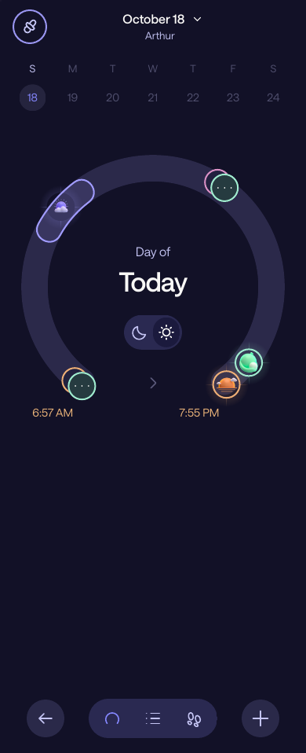
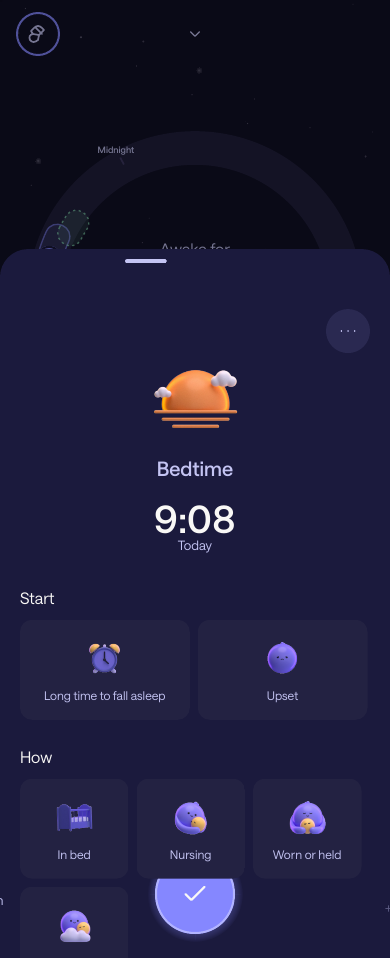
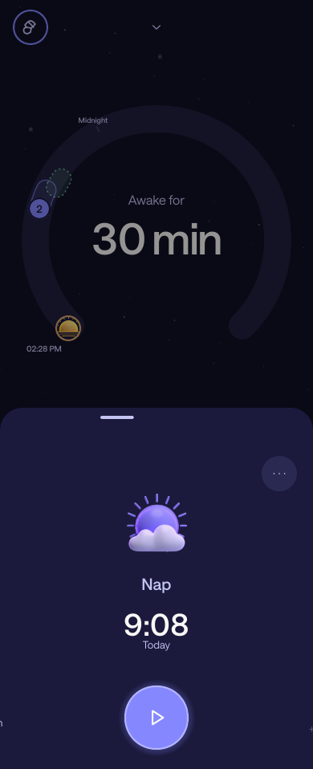
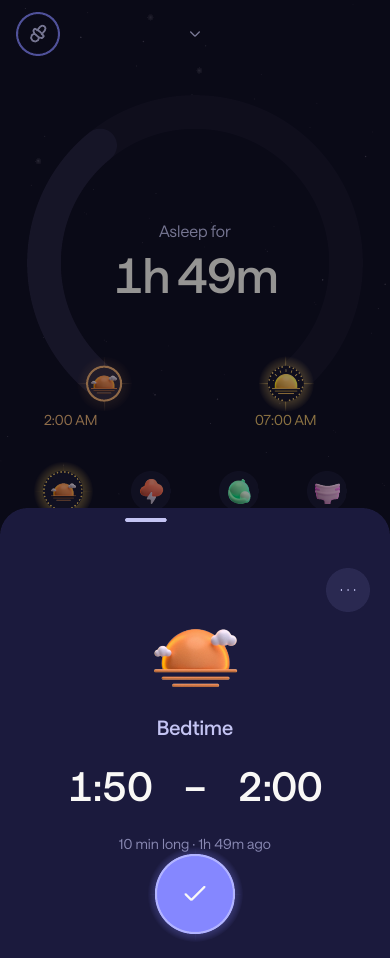

# Napper tracking UI parity

This revision replaces the earlier visual refresh with tracking layouts based on the supplied
Napper JavaScript, screenshots and the supplied `91733.mp4` / `91734.mp4` recordings. **Exact parity is still incomplete.** Broader Napper features,
remaining geometry/effects and installed-phone acceptance remain outstanding.

## References and recovered values

The supplied Hermes listing was inspected as a reference; it is not executed or included in the
repository. The palette declares `#121127` → `#1B1A3D` backgrounds, `#8587FF` primary purple,
`#C4C4F3` secondary text and `#F9F8F6` foreground. It references Saans Regular/Medium fonts and
bitmap activity symbols. Screenshot references show the dark surface for both Day and Night,
a large C-shaped dial, small status labels, icon actions with recency, persistent side controls
and collapsed record drawers with clock ranges.

The original warm HTML handoff predates the user's request for Napper parity; it no longer
sets the connected client's appearance. The separate local tracker remains available.

## Implemented

- Bundled the supplied Saans Regular/Medium/Italic fonts and original colored activity artwork.
- Added purple artwork variants to persistent Nap/Night-waking timers and font-load failure fallback.
- Dark connected surfaces for both cycles; moved cycle switching into an icon pill on the dial.
- Sized Home from the available viewport; reduced quick actions to four in Day and three in Night.
  Medicine and other supported actions remain in the three-column `+` menu.
- Removed the utility header and Home cycle pill; cycle switching lives in history and empty-cycle states.
- Kept midnight visible and placed timed markers at their start, independently of duration.
  Home markers near a wake/bedtime anchor use an inner rail at the same angle; nearby groups retain exact record IDs.
  Sleep intervals use quiet outlined bands; the completed Night no longer paints a bright full dial.
- Added drag feedback and animated layout changes between Home and history.
- Matched the supplied history comparison with a single date header, real calendar picker, smaller
  center text, wider C-shaped opening, moon/sun pill, plain gradient and separate circular dock buttons.
  The subtitle uses the profile name: age is not exposed by the current provider contract.
- History uses a single marker rail. Ellipsis groups include nearby boundaries and retain individual
  editor selection; short care intervals avoid an extra empty capsule. Nap symbols sit inside their
  duration band. These are history presentation rules; Home keeps its start-marker behavior.
  History has a Sunday–Saturday strip with future dates disabled, plus dial/list/recorded-total views.
  Its dock has Back, view selectors and Add; Home retains five positions. Sound/library slots remain inactive.
- Added an activity menu to `+`; historical dates still open past-activity entry directly.
- Added L/R switch, pause and resume to the persistent Nursing bar alongside its stop control.
- Removed the extra artwork rings in drawers and enlarged the symbols. Clock ranges omit repeated AM/PM.
- Moved primary actions and Nursing side controls into TrueSheet native floating footers.
  Bedtime initially opens at 74% with contextual fields; expanded drawers reach 94%.
- Added functional Start/How/comment fields for Bedtime/Nap and wake-mood/comment fields for waking.
  Draft patches save with timestamps through portable care commands; the adapter maps the observed Napper enums.
  Unedited supported provider fields and unknown enum values survive annotation edits.
- Added explicit end-time entry on a proposed Nap/waking, saving a completed interval instead of a live timer.
- Preserved exact timestamp drafts, continuous Nursing split updates and native TrueSheet ownership.
- Preserved the replaceable care ports, authoritative Napper writes and collision/stale-save guards.
- Preserved Bedtime as a routine interval, with independent Start/End editing. Night sleep, its dial
  anchor and Wake-up recency start at the routine's end. A 19:45–19:55 routine gives 1h 49m asleep at 21:44.
  Completed Bedtime opens as a compact range/duration drawer; its contextual fields appear on expansion.
- Fitted completed Day history to its real Wake-up → sleep-start bounds, keeping editable source IDs.
  Ticks outside those bounds disappear. Nearby groups show activity artwork, a count and a secondary
  symbol when they contain different activity kinds; short duration bands use a smaller visual minimum.

Individual Nap, Night waking, Nursing, Diaper and Medicine removal still requires confirmation
of the reviewed revision. The adapter rereads before DELETE and confirms absence afterwards;
uncertain outcomes require refresh. Bedtime/Wake-up deletion remains unavailable independently.

## Original assets and remaining differences

The supplied `Archive.zip` includes the missing Saans fonts and Android activity drawables.
Selected fonts and WebPs are bundled unchanged under `apps/mobile/assets/napper`; the full archive,
JavaScript bundle, account configuration and unrelated resources are excluded. Colored category
symbols appear on actions, dial markers, history and drawers; persistent sleep timers use their
purple variants. Universal controls retain vector glyphs. Resources load from the installed app,
without contacting Napper. The separate local tracker keeps its existing typeface and symbols.

Tracking waits for font registration before dismissing the splash screen. A font load failure
still opens the tracker with the system typeface. Typography selects the supplied Regular/Medium
files instead of synthesizing bold faces. Exact gradients, glows, animation and remaining geometry
are still under comparison; supplying the artwork alone does not establish full UI parity.

Sleep predictions, full Napper analytics, sounds and the sleep-content library
are not implemented by this tracking port. History totals describe recorded data only. No predictions, future wake-up anchors or working
sound/library destinations are fabricated. Full app parity includes those separate capabilities.

## Review and validation

`pnpm preview:ui` runs the actual connected components with synthetic records and browser adapters
for native sheets, pickers and SVG. Preview commands never contact Napper; ordinary writes show a
preview-only message and Remove affects synthetic memory only. `--build` creates a standalone
browser preview; `--static` emits static component markup; `--height=958` matches the recordings’ aspect ratio at 390 px width.

The PNGs below are **static component renders through a CSS print engine**, not browser/device
screenshots. The print engine can omit the full-screen SVG gradient and simplify glows; history
colors still need phone validation. The core layouts were also inspected at 320 × 740. They help inspect hierarchy and geometry; native font rendering, stacking, gestures, keyboard
behavior and safe areas still need Android/iPhone validation. No live browser visual pass is claimed.

| Day | Night |
| --- | --- |
|  |  |

| History | Bedtime | New Nap |
| --- | --- | --- |
|  |  |  |

| Night after Bedtime routine | Completed Bedtime routine |
| --- | --- |
|  |  |

| Completed Nap | Running Nursing | First Nursing |
| --- | --- | --- |
|  |  |  |

Validation passed: `pnpm check` (472 tests), the Lisbon timezone care/timeline suite
(167 tests), Android/iOS JavaScript exports and the standalone preview build.
The connected-home tests execute Expo's Android transform with React Compiler enabled, including
a production render. Startup tests cover pending/successful/failed font loading. They cover history navigation, empty-night cycle switching, the activity
menu, persistent Nursing controls, clock updates and reopened feeds. A marker regression verifies
that changing an activity's end does not move its start marker, and that an anchor and care record
at the same instant remain separate. Other regressions cover week navigation, future dates, completed
interval entry, annotation draft retention and the dependent Wake-up mood write. Bedtime regressions
cover readback and revision conflicts, independent endpoints, overnight and Lisbon clock rollback,
invalid ranges, transitions inside the routine and routine edits that overlap a recorded waking.
History regressions cover geometry-only reframing, mixed boundary/activity groups, exact selection after
chooser dismissal, and stable native calendar selection while the live clock ticks.

On a test profile, compare each state side by side with Napper on both phones: home, current and
historical cycles, first/active/paused/completed Nursing, Nap, Night waking, past care, exact time
editing, nearby records, removal, drawer dragging, enlarged fonts and the keyboard. No development
writes were made to the family's real account.
