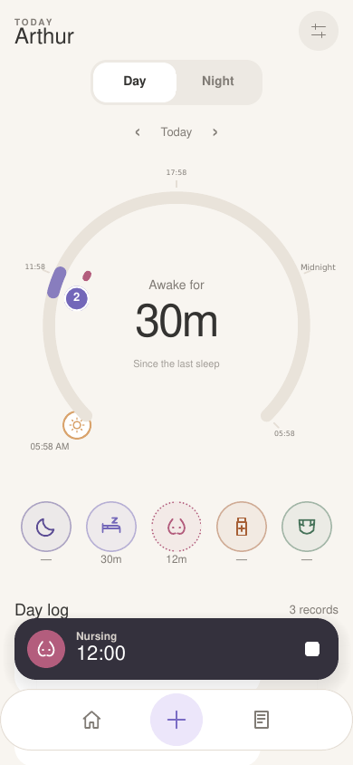
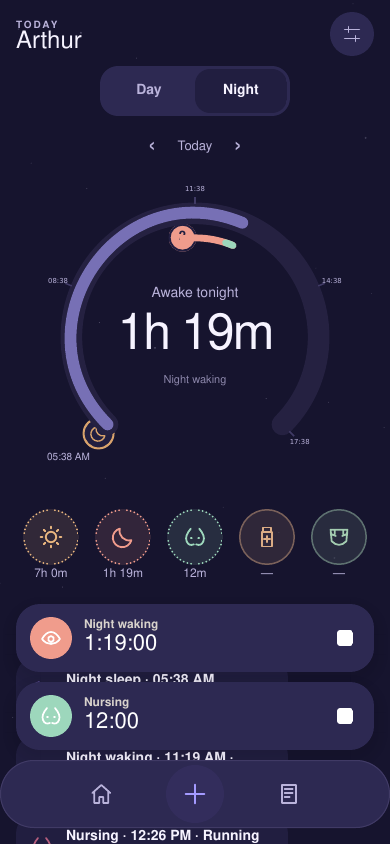
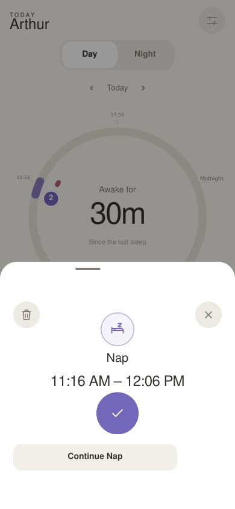
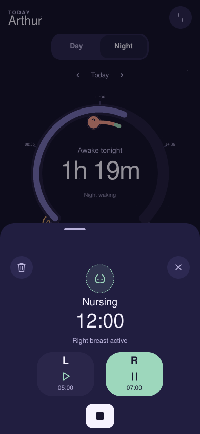
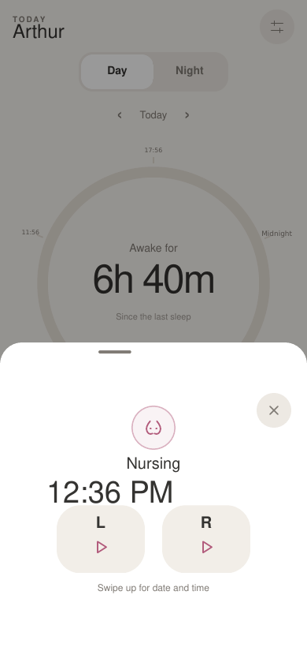

# Connected home and drawer refresh

The connected home now uses warm Day and dark Night surfaces. The dial gives the elapsed time
more space, with a smaller status label and compact recency beneath five icon actions. A bottom
dock opens past-activity creation and scrolls between the timeline and chronological log.
Persistent Nap/Night-waking and Nursing controls sit above that dock. Night sleep remains a phase,
without a separate stop timer. Profile, provider details and sign out live in the profile drawer.

The artwork is the app's own line-icon set. No Napper branding, extracted artwork or decompiled
code is included. The authoritative provider, UTC/timezone handling and collision guards are
unchanged by appearance. Native TrueSheet still owns detents, dragging, scrolling and dismissal;
nearby-record lists now use that same native sheet.

## Drawers and removal

Collapsed editors show the activity's clock time or start–end range. Running drawers show elapsed
time. Tapping a time or dragging up reveals exact fields. Nursing retains explicit Last, neutral
first-use sides and continuous split-slider updates. Check and stop actions have accessible labels.
Close/dismiss does not stop a timer.

Remove is available for Nap, Night waking, Nursing, Diaper and Medicine. It requires confirmation
inside the drawer, captures the reviewed revision, and sends `remove-activity` through `CareService`.
The Napper adapter uses the observed `DELETE /logs/{babyId}/{logId}` route without a cascade,
rereads first, rejects stale edits, shares the write lock and confirms absence afterwards. An
uncertain removal blocks retries until manual refresh; it never silently recreates a deleted record.

Bedtime/Wake-up removal is deliberately unavailable: a night boundary is linked to other sleep
records, and a separate cascade/recovery design is needed. Time editing remains available. The
Napper API's server-side concurrency limitations still apply.

## Review surfaces

`pnpm preview:ui` starts a development-only component surface at `http://127.0.0.1:4173`.
Use `?scenario=day`, `?scenario=night` or `?scenario=first-nursing`. It renders the actual connected
home and drawers with synthetic records. Native sheets, safe areas, pickers and SVG host elements
have browser adapters. Preview commands never contact Napper; most writes display a preview-only
message. The in-memory Remove demonstration affects synthetic preview records only.

`pnpm preview:ui --build` produces a standalone browser preview in the ignored preview/dist folder.
`pnpm preview:ui --static` emits static component markup for layout review. The preview folder is
excluded from Expo's TypeScript app compilation and is not imported by any app route.

The PNGs below are **static component renders**, produced from React Native Web markup through a
CSS print renderer. They are useful layout references, not browser or installed-phone screenshots;
font metrics, safe areas, stacking and native gestures require device acceptance. In this work
environment the cloud browser could not reach the local preview, so no live browser visual pass
is claimed.

| Day | Night |
| --- | --- |
|  |  |

| Completed Nap | Running Nursing | First Nursing |
| --- | --- | --- |
|  |  |  |

## Acceptance

Validation passed: `pnpm check` (440 tests in 45 files), the care/Napper and nearby-record suites
with `TZ=Europe/Lisbon` (129 tests), Android/iOS JavaScript exports and the standalone preview build.
On Android and iPhone, verify the five-action row at normal and enlarged font sizes, Day/Night
contrast, both live controllers above the dock, native handle expansion/dismissal, time editing,
first Nursing, active/completed Nursing, Medicine with the keyboard open, nearby-record selection,
and explicit removal on a disposable test record. The family's records were not used for writes.

The dense weekly view and night-boundary deletion are separate follow-ups.
