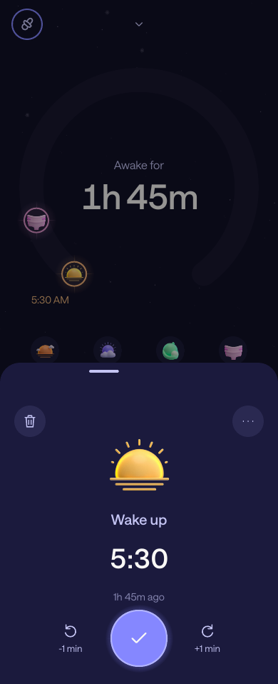
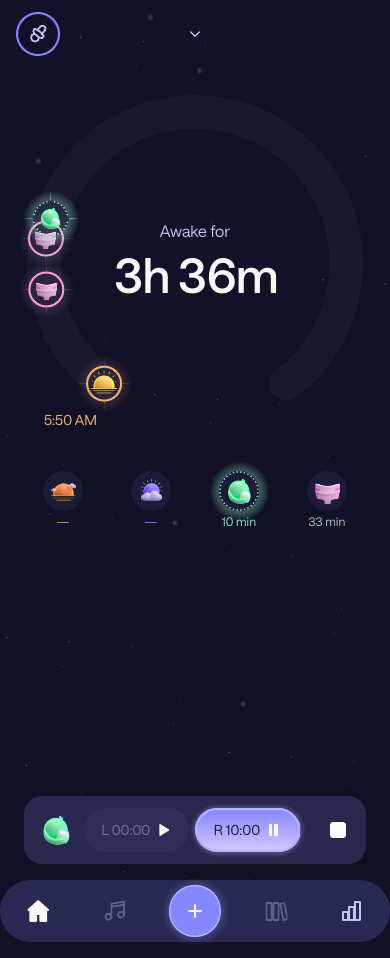
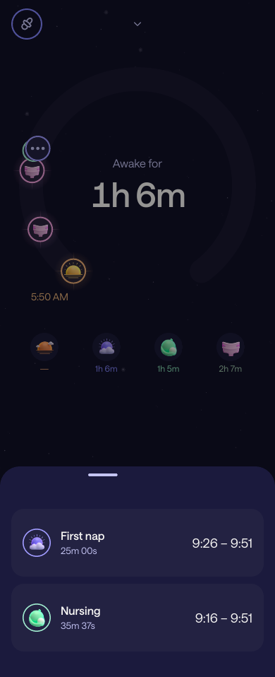
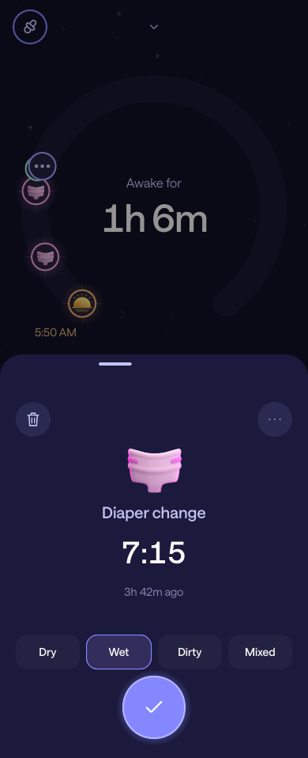
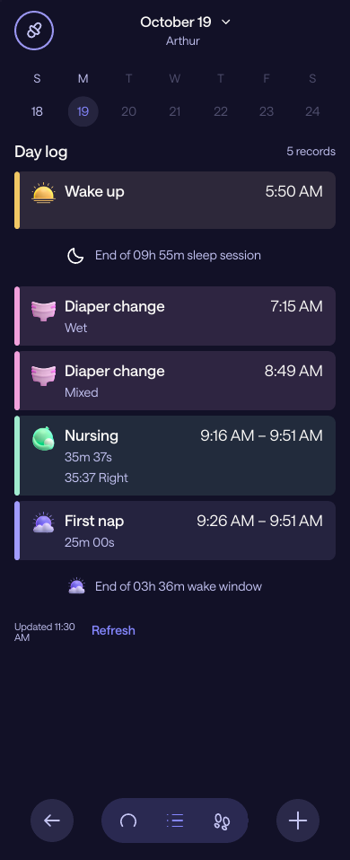
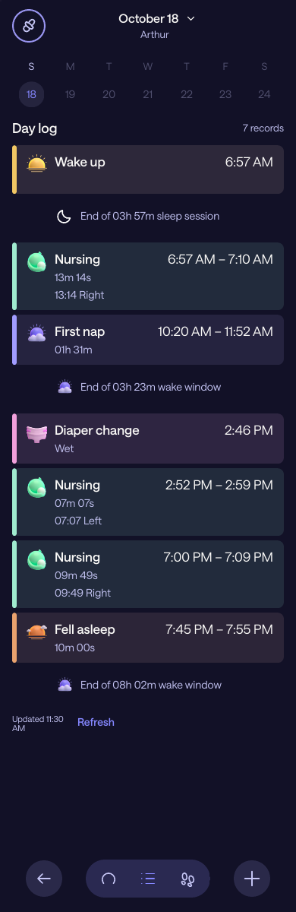
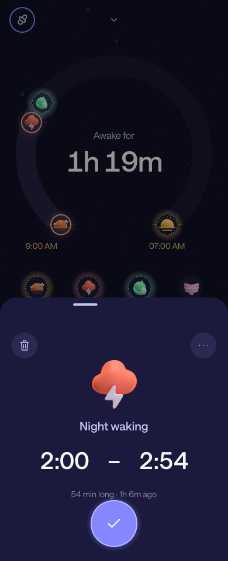
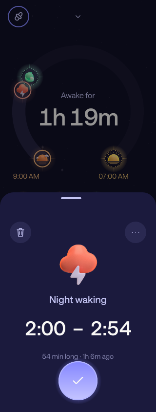
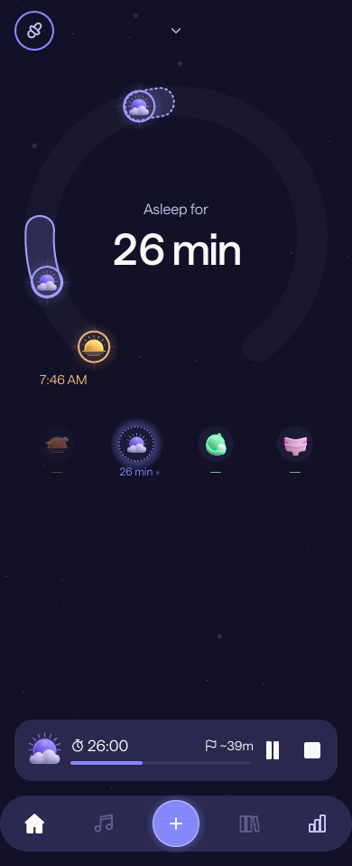
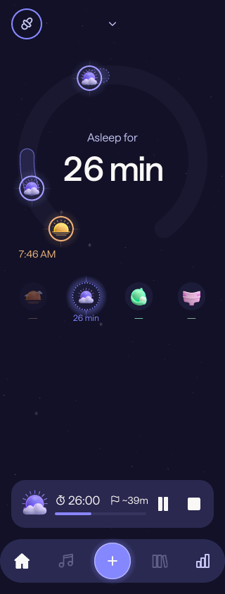

# Napper tracking UI parity

This revision replaces the earlier visual refresh with tracking layouts based on the supplied
Napper JavaScript, screenshots and the supplied `91733.mp4` / `91734.mp4` recordings. **Exact parity is still incomplete.** Broader Napper features,
remaining geometry/effects and installed-phone acceptance remain outstanding.

## References and recovered values

The supplied Hermes listing was inspected as a reference; it is not executed or included in the
repository. The palette declares `#121127` → `#1B1A3D` backgrounds, `#8587FF` primary purple,
`#C4C4F3` secondary text and `#F9F8F6` foreground. It references Saans Regular/Medium fonts and
bitmap activity symbols. Screenshot references show the dark surface for both Day and Night,
a large C-shaped dial, small status labels, icon actions with recency, persistent side controls
and collapsed record drawers with clock ranges.

The original warm HTML handoff predates the user's request for Napper parity; it no longer
sets the connected client's appearance. The separate local tracker remains available.

## Implemented

- Bundled the supplied Saans Regular/Medium/Italic fonts and original colored activity artwork.
- Added purple artwork variants to persistent Nap/Night-waking timers and font-load failure fallback.
- Dark connected surfaces for both cycles; moved cycle switching into an icon pill on the dial.
- Sized Home from the available viewport; kept four supported quick actions in both Day and Night.
  Medicine and other supported actions remain in the three-column `+` menu.
- Removed the utility header and Home cycle pill; cycle switching lives in history and empty-cycle states.
- Kept midnight visible and placed timed markers at their start, independently of duration.
  Connected markers and interval bands now use the same track centerline, including those near
  wake/bedtime anchors. Nearby groups retain exact record IDs rather than moving icons inward.
  Sleep intervals use quiet outlined bands; the completed Night no longer paints a bright full dial.
- Added drag feedback and animated layout changes between Home and history.
- Matched the supplied history comparison with a single date header, real calendar picker, smaller
  center text, wider C-shaped opening, moon/sun pill, plain gradient and separate circular dock buttons.
  The subtitle uses the profile name: age is not exposed by the current provider contract.
- History uses a single marker rail. Ellipsis groups include nearby boundaries and retain individual
  editor selection; short care intervals avoid an extra empty capsule. Nap symbols sit inside their
  duration band. These are history presentation rules; Home keeps its start-marker behavior.
  History has a Sunday–Saturday strip with future dates disabled, plus dial/list/recorded-total views.
  Its dock has Back, view selectors and Add; Home retains five positions. Sound/library slots remain inactive.
- Added an activity menu to `+`; historical dates still open past-activity entry directly.
- Added L/R switch, pause and resume to the persistent Nursing bar alongside its stop control.
  Matched its muted inactive pill, regular Saans timers, lavender active gradient and filled white
  play/pause glyphs to the supplied Nursing comparison. The bar is narrower, with smaller artwork.
- Reduced Diaper/Nursing artwork within dial badges, brightened the pink outline and added the active
  Nursing dotted mint ring. Partially overlapping badges remain individually visible at their real
  time angles; tighter overlap chains collapse into one opaque ellipsis badge with one backing ring,
  centered on the final member’s real angle. Short grouped intervals omit the extra capsule under
  the badge; the chooser retains every full interval and source ID. Badge-sized tap areas keep a
  neighboring target from covering the center of another badge.
- Replaced the full-height Nearby activities list with a compact, scrollable sheet of cards, ordered
  from the latest dial marker. Cards show Nap ordinal, measured active duration and full Start–End
  range. Nursing totals exclude pauses; selecting a card waits for dismissal before opening its editor.
- Kept all four Diaper types in the native floating footer above Save at both drawer sizes, with
  measured footer clearance for scrolling content. The compact drawer has room for the clock/age
  and choices; four equal-width buttons avoid wrapping/cropping on a narrow phone.
- Removed the extra artwork rings in drawers and enlarged the symbols. Clock ranges omit repeated AM/PM.
- Moved primary actions and Nursing side controls into TrueSheet native floating footers.
  Bedtime initially opens at 74% with contextual fields; expanded drawers reach 94%.
- Rebuilt the activity list with tinted cards, accent stripes, aligned time columns and recorded
  Start–End ranges for Nursing, Nap, Night waking and Bedtime. Diaper content uses title case;
  Nursing shows active duration and nonzero side totals. Day starts at Wake-up, including when a
  feed crosses that boundary; Night retains Bedtime-to-Wake-up order.
- Added non-editable end-of-wake-window and sleep-session summaries from the shared history.
  Night wakings split continuous sleep; Nap end starts the next wake window, and Bedtime’s end
  marks actual sleep. Missing or conflicting phase context does not produce an invented duration.
- Added functional Start/How/comment fields for Bedtime/Nap and wake-mood/comment fields for waking.
  Draft patches save with timestamps through portable care commands; the adapter maps the observed Napper enums.
  Unedited supported provider fields and unknown enum values survive annotation edits.
- Added explicit end-time entry on a proposed Nap/waking, saving a completed interval instead of a live timer.
- Preserved exact timestamp drafts, continuous Nursing split updates and native TrueSheet ownership.
- Preserved the replaceable care ports, authoritative Napper writes and collision/stale-save guards.
- Added a temporary 07:00 local wake estimate for active Nights, with a progress arc. It remains separate
  from recorded anchors and cannot be edited or saved as a Wake-up. Overdue estimates stay on the same
  morning; daylight-saving transitions use the session's IANA timezone. Active anchored Days use a 14h
  display window that expands with observed time; unanchored Days retain the full calendar-day window.
- Raised the Home dial, reduced its main timer, tightened action spacing and adjusted the dock/stars.
- Enabled confirmed Wake-up removal. Preflight rereads and revision checks precede DELETE; confirmed
  absence restores state from the remaining shared records. Removal is rejected if it would create
  new sleep collisions, including a Nap inside the reopened Night. Compact Wake-up includes age and ±1min.
- Preserved Bedtime as a routine interval, with independent Start/End editing. Night sleep, its dial
  anchor and Wake-up recency start at the routine's end. A 19:45–19:55 routine gives 1h 49m asleep at 21:44.
  Completed Bedtime opens as a compact range/duration drawer; its contextual fields appear on expansion.
- Fitted completed Day history to its real Wake-up → sleep-start bounds, keeping editable source IDs.
  Ticks outside those bounds disappear. Nearby groups retain their individual source activities
  behind the ellipsis badge; ungrouped short duration bands use a smaller visual minimum.

Individual Wake-up, Nap, Night waking, Nursing, Diaper and Medicine removal still requires confirmation
of the reviewed revision. The adapter rereads before DELETE and confirms absence afterwards;
uncertain outcomes require refresh. Bedtime deletion remains unavailable independently.

## Original assets and remaining differences

The supplied `Archive.zip` includes the missing Saans fonts and Android activity drawables.
Selected fonts and WebPs are bundled unchanged under `apps/mobile/assets/napper`; the full archive,
JavaScript bundle, account configuration and unrelated resources are excluded. Colored category
symbols appear on actions, dial markers, history and drawers; persistent sleep timers use their
purple variants. Universal controls retain vector glyphs. Resources load from the installed app,
without contacting Napper. The separate local tracker keeps its existing typeface and symbols.

Tracking waits for font registration before dismissing the splash screen. A font load failure
still opens the tracker with the system typeface. Typography selects the supplied Regular/Medium
files instead of synthesizing bold faces. Exact gradients, glows, animation and remaining geometry
are still under comparison; supplying the artwork alone does not establish full UI parity.

Personalized sleep predictions, full Napper analytics, sounds and the sleep-content library
are not implemented by this tracking port. History totals describe recorded data only. The temporary 07:00 estimate is a display-only fallback
authorized for this MVP; it is not a Napper prediction. Sounds/library remain inactive. Full app parity includes those separate capabilities.

## Review and validation

`pnpm preview:ui` runs the actual connected components with synthetic records and browser adapters
for native sheets, pickers and SVG. Preview commands never contact Napper; ordinary writes show a
preview-only message and Remove affects synthetic memory only. `--build` creates a standalone
browser preview; `--static` emits static component markup; `--height=958` matches the recordings’ aspect ratio at 390 px width.

The PNGs below are **static component renders through a CSS print engine**, not browser/device
screenshots. The print engine can omit the full-screen SVG gradient and simplify glows; history
colors still need phone validation. The core layouts were also inspected at 320 × 740. They help inspect hierarchy and geometry; native font rendering, stacking, gestures, keyboard
behavior and safe areas still need Android/iPhone validation. No live browser visual pass is claimed.

| Day | Night |
| --- | --- |
|  |  |

| History | Bedtime | New Nap |
| --- | --- | --- |
|  |  |  |

| Night after Bedtime routine | Completed Bedtime routine |
| --- | --- |
|  |  |

| Night with 07:00 estimate | Day marker alignment | Wake-up controls |
| --- | --- | --- |
|  |  |  |

| Completed Nap | Running Nursing | First Nursing |
| --- | --- | --- |
|  |  |  |

| Grouped dial | Nearby activity cards | Compact Diaper controls |
| --- | --- | --- |
|  |  |  |

| Day log | Completed Day with Bedtime routine |
| --- | --- |
|  |  |

The completed-Day log render uses a taller viewport to review the full list without scrolling.

| Completed duration band | Night waking endpoints | Narrow Night waking (320px) |
| --- | --- | --- |
|  |  |  |

Duration bands are selectable along their whole visible filled area, including the rounded end.
A grouped interval opens the same nearby-record chooser as its marker; standalone intervals open
their exact record. Home and History use a 28-unit band with a stronger outline and rounded caps.
The geometry still uses the real start/end angles. Disabled views block arc actions.

The large drawer range has independent Start and End buttons. Tapping End initializes the picker
from the end instant, even while the Start picker is already open. Completed Bedtime and Night waking
end changes retain the original start and reviewed revision. Active sleep still has a read-only end.

| Running Nap | Paused Nap | Narrow Nap bar (320px) |
| --- | --- | --- |
|  |  |  |

The Nap bar uses activity artwork, a stopwatch, regular-weight elapsed time, estimated remaining
minutes, a progress track and separate Pause/Resume and Stop controls. Remaining time is marked `~`:
it is a display-only average of up to seven valid preceding completed naps in the current snapshot,
with a 60-minute fallback. It is not Napper's forecast and is never saved as an activity. Both elapsed
time and progress exclude pauses and freeze while paused; overdue estimates stay full without
negative remaining time. The estimate's source is included in accessibility text. Buttons retain
the reviewed record revision and use the existing care-service commands and write guards.

Validation passed: `pnpm check` (515 tests), the Lisbon timezone care/timeline suite
(210 tests), Android/iOS JavaScript exports and the standalone preview build.
The connected-home tests execute Expo's Android transform with React Compiler enabled, including
a production render. Startup tests cover pending/successful/failed font loading. They cover history navigation, empty-night cycle switching, the activity
menu, persistent Nursing controls, clock updates and reopened feeds. A marker regression verifies
that changing an activity's end does not move its start marker, and that an anchor and care record
at the same instant remain separate. Other regressions cover week navigation, future dates, completed
interval entry, annotation draft retention and the dependent Wake-up mood write. Bedtime regressions
cover readback and revision conflicts, independent endpoints, overnight and Lisbon clock rollback,
invalid ranges, transitions inside the routine and routine edits that overlap a recorded waking.
Dial regressions keep a Diaper and feed 23 minutes apart individually visible without changing their
angles, while tighter overlap chains retain exact record selection under a single badge. Additional
checks cover chooser duration/ranges and exact Nursing handoff after dismissal, plus Diaper category
selection surviving drawer expansion/collapse and retaining the reviewed revision on Save. History regressions cover geometry-only reframing, mixed boundary/activity groups, exact selection after
chooser dismissal, and stable native calendar selection while the live clock ticks. Wake-up removal
also covers reopened Night state, preserved diapers, stale revisions, Nap collisions and uncertain
outcomes. Forecast tests cover Lisbon DST, overdue estimates and separation from recorded boundaries.

Duration interaction tests cover standalone Home/History arcs, grouped chooser handoff after
dismissal and disabled actions. Time-picker tests cover direct End taps on Bedtime/Night waking,
clock ticks, switching endpoints while open and canceling without writes.

Nap bar regressions cover pause/resume/stop with the reviewed revision, disabled controls, frozen
paused values, sample filtering, the seven-record limit, fallback and overdue progress.

Log regressions cover complete ranges, active versus elapsed duration, Bedtime routine endpoints,
continuous Night sleep after waking, concurrent care, absent/conflicting context, Lisbon rollback,
Wake-up ties/carryover feeds, Night ordering and exact editor handoff.

On a test profile, compare each state side by side with Napper on both phones: home, current and
historical cycles, first/active/paused/completed Nursing, Nap, Night waking, past care, exact time
editing, nearby records, removal, drawer dragging, enlarged fonts and the keyboard. No development
writes were made to the family's real account.
